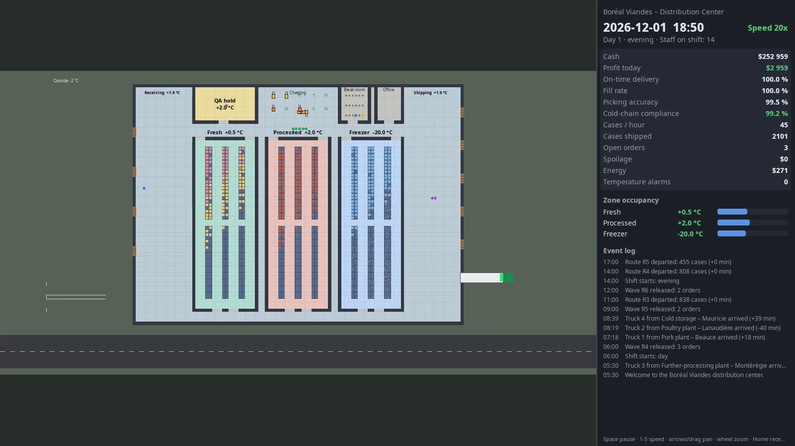
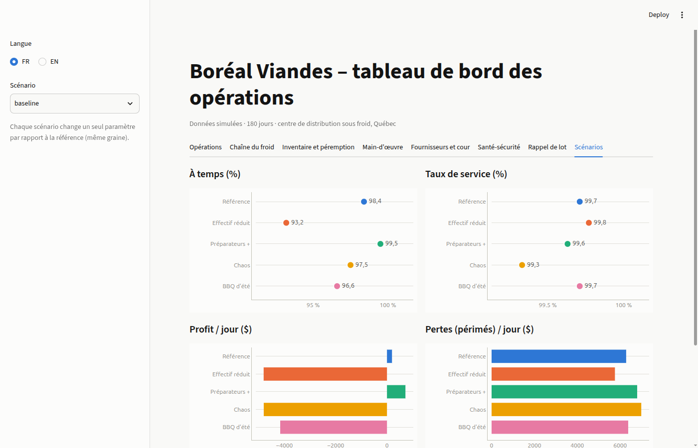

# Boréal Viandes – Cold-Chain Warehouse Simulation

An animated simulation of a refrigerated meat **distribution center** in Québec. It also
**generates realistic operational data** for dashboards and machine-learning models that answer
the questions a distribution-center manager asks every day:

- How many pickers do we need tomorrow?
- Which pallets will expire before they ship?
- Which orders are at risk of leaving late?
- Is the freezer drifting toward an alarm?
- What happens to cost and service if we cut or add staff?

The company, plants, stores and products are fictional. The data is simulated on purpose: the
generating process is known, so every model can be checked against a controlled ground truth.


## What is simulated

| Area | Details |
|---|---|
| **Scale** | About 25,000 cases a day to 48 stores on 16 routes. 6 receiving and 14 shipping doors, 3 cold rooms with 4,600 rack positions on 5 levels, 78 staff over three shifts. |
| **Inbound** | 53' reefer trailers carrying 26–30 pallets from 4 plants, which arrive in an overnight and early-morning rush. Trailers wait in the yard until a door and a dock worker are free, then go through a 15-minute check-in. A probe temperature check decides accept, QA hold or reject. Reefer failures happen. |
| **Put-away** | A taxi driver moves pallets from the dock to the drop points at the aisle ends, 2 at a time. A reach-truck driver then lifts each pallet into the high racks. |
| **Storage** | Fresh (-1 to 2 °C), processed (0 to 4 °C) and freezer (-20 °C) rooms. Each pallet has a lot, a pack date and a best-before date. Product temperature lags room air (thermal mass), and excursions go to QA. |
| **Orders** | 12 stores (grocery, club, restaurant) on 6 delivery routes with cutoffs. Demand follows weekday, seasonal (Christmas ham, summer BBQ, BBQ heat sensitivity) and random variation. |
| **Picking & shipping** | FEFO picking onto mixed pallets with catch weights. Pallets are wrapped, staged, and loaded last stop first (at most 30 pallets per trailer). Empty outbound trailers are dropped in the yard hours ahead and pulled to their door for loading. |
| **People & equipment** | Day, evening and night shifts. Receivers, taxi drivers, reach-truck drivers, pickers, loaders and QA, each with an individual skill. A fleet of 18 forklifts with batteries, chargers and breakdowns. |
| **Events** | Late trucks, reefer failure, freezer door stuck open, forklift breakdown, sick calls, rush orders, lot recalls with traceability. |
| **Safety incidents** | Workplace injuries at the Canadian lost-time rate for warehousing (1.30 per 100 workers per year), and forklift accidents split as in Québec serious-accident data (struck pedestrian, tip-over, crushed by the load). Property damage follows Bird's safety triangle: rack strikes close a bay, and dropped pallets destroy product. An injured worker is off for days and their shift runs short. Every value and its source is in `config.py` and the data dictionary. |
| **Economy** | Revenue per case, wages, energy (the freezer costs the most), spoilage, penalties, and the cold-chain compliance KPI. |

The interface is French (Québec) by default; press **L** for English.



## Quick start

```bash
python -m venv .venv && source .venv/bin/activate
pip install -r requirements.txt        # pygame-ce only
python main.py
```

| Key | Action |
|---|---|
| Space | Pause |
| 1 – 5 | Speed 1x / 2x / 5x / 10x / 20x |
| Arrows or drag | Pan |
| Mouse wheel | Zoom |
| Home | Recenter |
| L | Français ↔ English |
| F5 / F9 | Save / load |

## Generate data (headless)

```bash
python main.py --headless --days 180 --seed 42 --scenario baseline
python analytics/multiseed.py run --jobs 10    # every scenario × seeds 7, 11, 23, 42, 99 (about 3 min a run)
python analytics/multiseed.py build            # -> data/seeds/multiseed.duckdb + one SQLite per seed
python analytics/multiseed.py ml               # retrain the 5 models on each seed
python analytics/multiseed.py report           # -> docs/MULTISEED.md (mean ± sd, paired 95 % intervals)
```

The data is written as a star schema of CSV tables to `data/<scenario>_seed<seed>/`. It loads
straight into Power BI, pandas or SQLite. Runs are reproducible: the same seed gives the same
data, and 60 simulated days take about 11 seconds.

- **Dimensions:** `dim_sku`, `dim_store`, `dim_route`, `dim_plant`, `dim_zone`, `dim_worker`
- **Facts:** `fact_orders`, `fact_order_lines`, `fact_picks`, `fact_shipments`, `fact_shipment_lots`,
  `fact_pallet_receipts`, `fact_inbound_trucks`, `fact_putaway`, `fact_inventory_daily`,
  `fact_temperature`, `fact_energy_daily`, `fact_weather`, `fact_labor`, `fact_equipment`,
  `fact_events`, `fact_daily_kpi`

Every table and column is documented in **[DATA_DICTIONARY.md](DATA_DICTIONARY.md)**,
including the cause-and-effect built into the data.

## SQL analytics

```bash
pip install -r requirements-analytics.txt
python analytics/build_db.py                       # all runs in data/ -> data/warehouse.db (SQLite star schema)
python analytics/run_sql.py                        # run every KPI query (scenario baseline)
python analytics/run_sql.py 06 --scenario chaos    # one query, another scenario
```

**DuckDB** (columnar, typed, about 5 seconds to build and 220 MB against 1.7 GB for SQLite):

```bash
python analytics/build_duckdb.py --parquet          # -> data/warehouse.duckdb (+ data/parquet/, partitioned by scenario)
python analytics/run_sql.py --engine duckdb          # the same nine queries, same numbers
python analytics/run_sql.py --engine duckdb --file analytics/duckdb_examples.sql
```

The DuckDB database has real `TIMESTAMP` and `DATE` columns, keeps barcodes as text, and adds four
views: `v_pallet_history` (each pallet's numbered scans), `v_dock_to_stock`, `v_lot_trace` (lot →
outbound pallet → store) and `v_order_service`. [analytics/duckdb_examples.sql](analytics/duckdb_examples.sql)
shows what SQLite can't do easily: percentiles, ABC analysis with window functions, `QUALIFY`, `PIVOT`,
and a recall summary.

`analytics/sql/` holds the nine queries a distribution-center manager asks for: daily OTIF,
service by customer, cold-chain compliance, expiry risk, picker productivity, supplier scorecard,
recall trace, scenario comparison and spoilage drivers. For example, the supplier scorecard and the
spoilage-drivers query show that **every spoiled pallet came from an aged load (98 % of them poultry)**,
which arrived with less than 3 days of shelf life left.

Scenarios for what-if comparisons (180 simulated days, seed 42, from `analytics/sql/08_scenario_comparison.sql`):

| Scenario | On-time | Fill rate | Wages / day | Late fines and expedites / day | Profit / day |
|---|---|---|---|---|---|
| `baseline` | 98.8 % | 99.62 % | $16,330 | $2,248 | $2,534 |
| `lean_staff` (2 pickers fewer per shift, fewer drivers) | 93.0 % | 99.76 % | $15,241 | $5,810 | $259 |
| `extra_pickers` (+4 pickers per shift) | 100.0 % | 99.85 % | $18,418 | $628 | $2,849 |
| `chaos` (3x more incidents and accidents) | 98.9 % | 99.22 % | $16,339 | $3,559 | -$1,272 |
| `summer_bbq` (June start, BBQ peak) | 98.6 % | 99.59 % | $16,376 | $2,677 | $9,004 |

One run is one draw, so every scenario was rerun with five seeds (7, 11, 23, 42, 99) and compared with
the baseline run of the same seed. Weather, plant delays and order noise are then shared and cancel out.
The full tables, with ± sd for every KPI and the per-seed ML results, are in
**[docs/MULTISEED.md](docs/MULTISEED.md)** (generated by `analytics/multiseed.py`):

| vs baseline, per day (5 seeds) | Wages | Late fines and expedites | Profit (95 % interval) | Profit higher in |
|---|---|---|---|---|
| `lean_staff` | −$1,163 | +$3,283 | **−$2,624** (−$4,174 to −$1,073) | 0 of 5 seeds |
| `extra_pickers` | +$2,015 | −$754 | −$940 (−$2,512 to +$633) | 1 of 5 seeds |

**Solid finding:** lean staffing loses money with every seed. It saves $1,163 a day in wages but costs
$3,283 more in late-delivery fines (3 % of the order value, as in retailer OTIF programs) and expedites.
**Seed 42 was the exception:** it is the only seed where extra pickers made more profit. Over five seeds
they cost $2,015 more in wages and save only $754 in fines, a net cost of about $1,260 a day, so the
baseline crew is the better fixed crew. Profit itself swings by ±$1,178 a day between seeds, which is
why one run could not decide. The labour-planning model goes further: it varies the crew by day
instead of choosing one fixed size.

## Tests

```bash
pip install -r requirements-dev.txt
python -m pytest tests/ -q
```

## Dashboards

**Power BI** (the main deliverable): `python analytics/export_powerbi.py` writes a Power BI-ready
star schema to `data/powerbi/`. **[dashboard/POWERBI_GUIDE.md](dashboard/POWERBI_GUIDE.md)** covers the
relationships, the 17 DAX measures (OTIF, fill rate, cases per picker hour, cold-chain compliance,
yard wait, supplier on-time, lost-time injury rate…) and the layout of 8 report pages. It also gives
the value each measure must show, computed in Python from the same files, so the report can be
checked number by number. A matching theme (colour-blind-checked palette) is in
`dashboard/boreal_theme.json`.

**Streamlit mirror** (runs on Linux, same pages, French and English, every card compared with the baseline):

```bash
streamlit run dashboard/app.py
```




## WMS scan log, AS/400 extract and SAS

Every pallet carries a GS1 **SSCC-18 licence plate** and every case a **GTIN-14**. Each scan is
logged like a real WMS: received at the door (with the probe temperature and the PO), taxi to the drop
point, put away in `FR-03-17-C`, picked (cases and catch weight, from which pallet to which outbound
pallet), wrapped, loaded on the trailer (bill of lading) and shipped. The item master has pieces per case,
net/tare/gross weight, case dimensions, Ti × Hi and storage temperatures. See `fact_transactions`,
`dim_sku` and `dim_location` in the [data dictionary](DATA_DICTIONARY.md).

Many Québec distributors still run their WMS on an **IBM AS/400**, and their analysts use **SAS**:

```bash
python analytics/export_as400.py      # -> data/as400/: ITMMST, LOCMST, ITHTRN, POHDR, PODTL, ORDHDR, ORDDTL, SHPHDR...
```

The files are fixed width, Windows-1252, with 10-character field names and `CYYMMDD` dates, plus a
layout per file. [sas/](sas/README.md) has the generated import program and analyses: dock-to-stock
time, picker productivity, lot trace for a recall (`%trace(lot=)`), supplier scorecard, and OTIF by route.

## Machine learning

```bash
python ml/train_all.py      # all five models in about 10 s; results in ml/RESULTS.md, cards in ml/README.md
```

Each model is tested on the last 60 days (never seen in training) against the method a distribution
center uses today. **[ml/README.md](ml/README.md)** has a model card for each (decision, features, leakage
checks, $ assumptions, limits), and **[ml/RESULTS.md](ml/RESULTS.md)** holds the generated numbers for
seed 42. Every model was also retrained on each of the five seeds
([docs/MULTISEED.md](docs/MULTISEED.md)); the table gives seed 42 with the five-seed mean ± sd in brackets.

| Model | Result vs today's method | Value / day |
|---|---|---|
| Demand forecast | Store × SKU error 37 % vs 52 % (same weekday last week); 36.8 % ± 0.2 vs 51.9 % ± 0.2 over five seeds | $2,356 (5 seeds: $3,285 ± 598) |
| Labour planning | A capacity curve fitted from the data (service collapses above ≈ 89 cases per picker-hour) plus the forecast: 297 picker-hours a day instead of 350 | $1,129 (5 seeds: $1,250 ± 89) |
| Late-order risk | PR-AUC 0.17 vs 0.02 for the largest-orders rule (5 seeds: 0.32 ± 0.13 vs 0.02 ± 0.01); top drivers are picker load, departure hour and pickers present (the true mechanism). The model beats the rule with every seed, but by how much swings, because late orders are rare (0.4–1.4 % of test orders). | $45 (5 seeds: $111 ± 71) |
| Cold-room early warning | Warns 28 min before a breach vs 14 min for a fixed pre-alarm, with fewer alerts (5 seeds: 28 ± 0 vs 13 ± 0 min) | not monetised |
| Spoilage risk | **A simple rule wins with every seed** ("fewer than 3 days left at receipt" is 99 % precise): net $925 ± 148 a day for the rule vs $397 ± 242 for the model. The fix is upstream: every spoiled pallet comes from an aged load, mostly from the poultry plant. | rule recommended |

## Record videos

```bash
python main.py --record videos/day.mp4 --hours 24 --speed 20 --camera site
```

This renders offscreen and needs `ffmpeg`. The camera presets are `site`, `receiving`,
`shipping`, `freezer`, `picking`, `yard` (the receiving doors and the trailer queue) and `taxi`. Use `--warmup H` to skip ahead to a busy hour, and
`--lang en` for English.

## Project layout

| File | Role |
|---|---|
| `config.py` | Every tuning number, product, store, plant and scenario |
| `simulation.py` | All warehouse logic on a fixed time step (no pygame, runs headless) |
| `models.py` | Dataclasses: SKU, Pallet, RackSlot, Truck, Order, Worker, Forklift… |
| `pathfinding.py` | A* on the floor grid |
| `events.py` | Random and seasonal events |
| `datalog.py` | CSV star-schema export |
| `renderer.py`, `ui.py` | Drawing, camera, sidebar |
| `i18n.py` | French / English text |
| `main.py` | Game loop, headless mode, video recording |

## Roadmap

- [x] Simulation core, animated game, headless data export, video recording
- [x] Tests: case conservation, reproducibility, no-deadlock regressions, save/load, staffing signal
- [x] Economy and realism calibration: staffing and events move service levels (table below)
- [x] Data dictionary, SQLite star schema and KPI SQL queries
- [x] Realistic supply problems: short shipments, aged loads, buyer order error (spoilage ≈ 0.5 %, fill rate ≈ 99.4 %)
- [x] Dashboards: Power BI export, guide and theme, plus a Streamlit mirror (operations, cold chain, inventory, labour, suppliers & yard, safety, recall trace, scenarios)
- [x] ML models, each against a naive baseline with the $ impact: demand forecast, labour planning, spoilage risk (a rule wins), late-order risk, cold-room early warning
- [x] Multi-seed evaluation: every scenario and model over 5 seeds, with paired differences and 95 % intervals
- [ ] Closed-loop test: run the simulation with the ML labour plan and measure the real savings

## Tech

Python 3.11+, pygame-ce. The analytics layer uses pandas, scikit-learn, Streamlit and Plotly.
