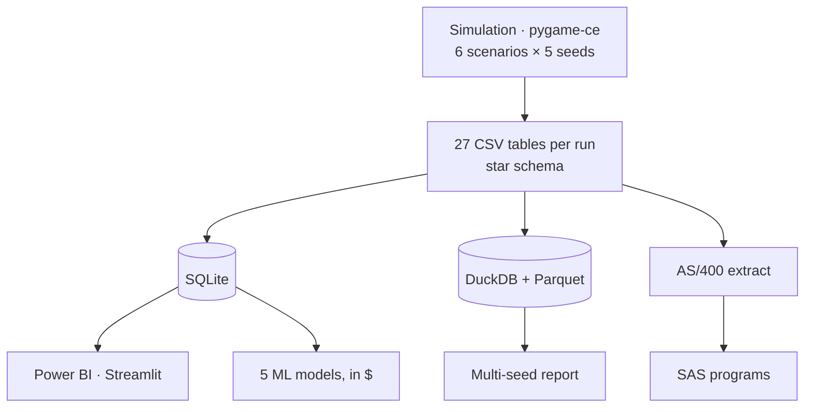
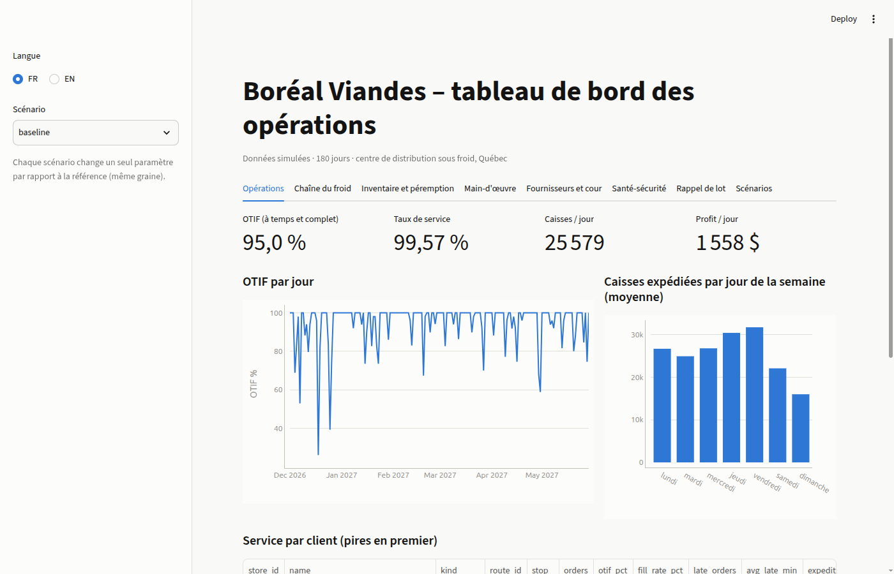
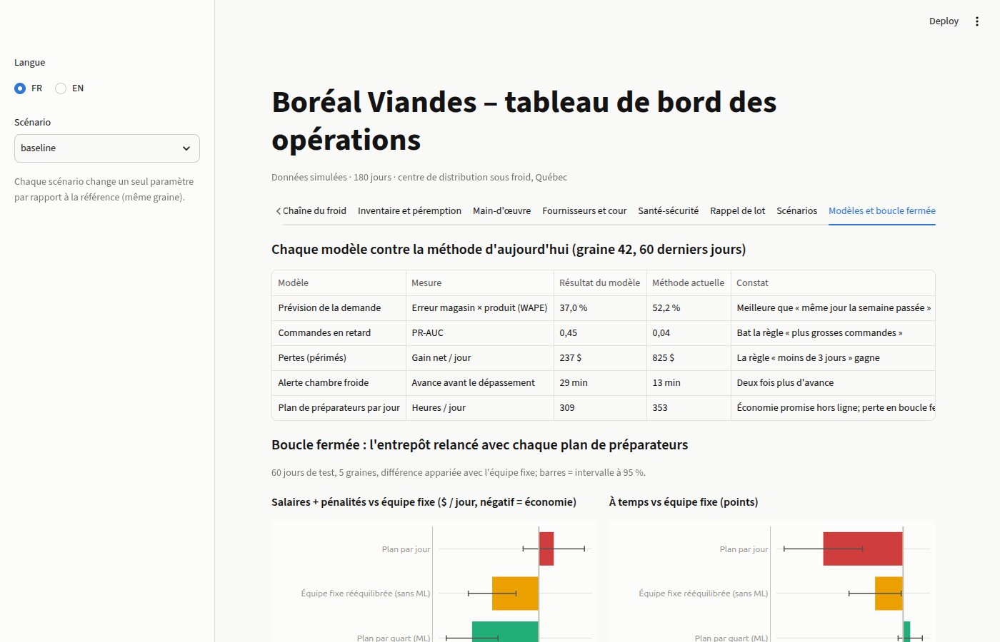

# Boréal Viandes – Cold-Chain Warehouse Simulation

[](https://github.com/KevinSeyranoglu/boreal-viandes-warehouse-sim/actions/workflows/tests.yml)


**Short on time? Read the 2-page case study: [English](docs/CASE_STUDY.md) · [Français](docs/ETUDE_DE_CAS.md)**

A simulated refrigerated meat **distribution center** in Québec. It produces the data a warehouse
analyst works with: WMS scans, orders, picks, labour, yard, temperatures and incidents. On top of it
is the full analytics stack: **SQL, DuckDB, Power BI, Streamlit, an AS/400 extract read by SAS, and
five ML models**. Each model is measured in dollars against the method a distribution center uses today.


## Results at a glance

Every number below holds across 5 random seeds ([docs/MULTISEED.md](docs/MULTISEED.md)): each
scenario is compared with the baseline run of the same seed, with a 95 % interval.

| Question a DC manager asks | Answer from the data |
|---|---|
| Should we cut pickers to save wages? | **No.** Lean staffing saves $1,210 a day in wages but pays $3,096 more in late fines and expedites: **−$3,209 a day** (−$4,705 to −$1,713), worse with all 5 seeds. |
| Should we add pickers instead? | **Not as a fixed crew.** On-time rises to 99.6 %, but $1,977 a day of wages buys only $526 of fines avoided. Profit is higher with 1 seed of 5 (−$2,815 a day on average). A single run (seed 42) said the opposite. |
| How many pickers do we need tomorrow? | **Plan per shift, not per day.** A daily crew plan promised $815 a day offline but **lost money when simulated** (on-time −3.9 points). The diagnosis: the evening shift had 18 pickers for 5 % of the picking. A per-shift plan (demand forecast + one capacity curve per shift) **saves $3,498 a day in wages and fines** (−$4,853 to −$2,143) with on-time unchanged, in closed loop over 5 seeds ([docs/CLOSED_LOOP.md](docs/CLOSED_LOOP.md)). |
| One worker owns each trailer: what does it take? | Loading alone, the owner needs 22 min after the last pallet is staged instead of 3 min with whoever is free, and on-time fell 3–4 points. **Releasing waves 5 h before departure instead of 4 restored it at no cost**; adding loaders recovered less for about $1,000 a day. |
| Can one dock wall both receive and ship? | **Yes, with a longer yard wait.** 14 shared doors on one wall (instead of 6 + 14 on two walls, in a 6 % narrower building) keep on-time and dock-to-stock within the noise; trailers wait **8 minutes longer** at the gate (+6.5 to +10.0). |
| Which pallets will spoil? | **A one-line rule beats the ML model** with every seed ("fewer than 3 days of shelf life at receipt"). Every spoiled pallet traces to an aged poultry load: the fix is a supplier contract clause, not a model. |

## How it fits together



**Skills shown:** SQL (window functions, `QUALIFY`, views), Python and pandas, DuckDB and Parquet,
Power BI and DAX, SAS, scikit-learn (time-based splits, leakage checks, permutation importance), experiment
design (paired seeds, confidence intervals), and software practice (a pytest suite run by CI on every push,
reproducible seeded runs).

The company, plants, stores and products are fictional. The data is simulated on purpose: the
generating process is known, so every model can be checked against a controlled ground truth.

## What is simulated

| Area | Details |
|---|---|
| **Scale** | About 25,000 cases a day to 48 stores on 16 routes. 6 receiving and 14 shipping doors, 3 cold rooms with 4,600 rack positions on 5 levels, 78 staff over three shifts. |
| **Inbound** | 53' reefer trailers carrying 26–30 pallets from 4 plants, which arrive in an overnight and early-morning rush. Trailers wait in the yard until a door and a dock worker are free, then go through a 15-minute check-in. A probe temperature check decides accept, QA hold or reject. Reefer failures happen. |
| **Put-away** | A taxi driver moves pallets from the dock to the drop points at the aisle ends, 2 at a time. A reach-truck driver then lifts each pallet into the high racks. |
| **Storage** | Fresh (-1 to 2 °C), processed (0 to 4 °C) and freezer (-20 °C) rooms. Each pallet has a lot, a pack date and a best-before date. Product temperature lags room air (thermal mass), and excursions go to QA. |
| **Orders** | 48 stores (grocery, club, restaurant) on 16 delivery routes with cutoffs. Demand follows weekday, seasonal (Christmas ham, summer BBQ, BBQ heat sensitivity) and random variation. |
| **Picking & shipping** | FEFO picking onto mixed pallets with catch weights. Pallets are wrapped, staged, and loaded last stop first (at most 30 pallets per trailer). Empty outbound trailers are dropped in the yard hours ahead and pulled to their door for loading. |
| **People & equipment** | Day, evening and night shifts. Receivers, taxi drivers, reach-truck drivers, pickers, loaders and QA, each with an individual skill. A fleet of 18 forklifts with batteries, chargers and breakdowns. |
| **Events** | Late trucks, reefer failure, freezer door stuck open, forklift breakdown, sick calls, rush orders, lot recalls with traceability. |
| **Safety incidents** | Workplace injuries at the Canadian lost-time rate for warehousing (1.30 per 100 workers per year), and forklift accidents split as in Québec serious-accident data (struck pedestrian, tip-over, crushed by the load). Property damage follows Bird's safety triangle: rack strikes close a bay, and dropped pallets destroy product. An injured worker is off for days and their shift runs short. Every value and its source is in `config.py` and the data dictionary. |
| **Economy** | Revenue per case, wages, energy (the freezer costs the most), spoilage, penalties, and the cold-chain compliance KPI. |

The interface is French (Québec) by default; press **L** for English.


## Quick start

```bash
python -m venv .venv && source .venv/bin/activate
pip install -r requirements.txt        # pygame-ce only
python main.py
```

| Key | Action |
|---|---|
| Space | Pause |
| 1 – 5 | Speed 1x / 2x / 5x / 10x / 20x |
| Arrows or drag | Pan |
| Mouse wheel, or + / − (also keypad, Page Up / Page Down) | Zoom (hold the key for a smooth zoom) |
| Home | Recenter |
| L | Français ↔ English |
| F5 / F9 | Save / load |

## Generate data (headless)

```bash
python main.py --headless --days 180 --seed 42 --scenario baseline
python analytics/multiseed.py run --jobs 10    # every scenario × seeds 7, 11, 23, 42, 99 (about 3 min a run)
python analytics/multiseed.py build            # -> data/seeds/multiseed.duckdb + one SQLite per seed
python analytics/multiseed.py ml               # retrain the 5 models on each seed
python analytics/multiseed.py report           # -> docs/MULTISEED.md (mean ± sd, paired 95 % intervals)
```

The data is written as a star schema of CSV tables to `data/<scenario>_seed<seed>/`. It loads
straight into Power BI, pandas or SQLite. Runs are reproducible: the same seed gives the same
data, and 60 simulated days take about 11 seconds.

- **Dimensions:** `dim_sku`, `dim_store`, `dim_route`, `dim_plant`, `dim_zone`, `dim_worker`
- **Facts:** `fact_orders`, `fact_order_lines`, `fact_picks`, `fact_shipments`, `fact_shipment_lots`,
  `fact_pallet_receipts`, `fact_inbound_trucks`, `fact_putaway`, `fact_inventory_daily`,
  `fact_temperature`, `fact_energy_daily`, `fact_weather`, `fact_labor`, `fact_equipment`,
  `fact_events`, `fact_daily_kpi`

Every table and column is documented in **[DATA_DICTIONARY.md](DATA_DICTIONARY.md)**,
including the cause-and-effect built into the data.

## SQL analytics

```bash
pip install -r requirements-analytics.txt
python analytics/build_db.py                       # all runs in data/ -> data/warehouse.db (SQLite star schema)
python analytics/run_sql.py                        # run every KPI query (scenario baseline)
python analytics/run_sql.py 06 --scenario chaos    # one query, another scenario
```

**DuckDB** (columnar, typed, about 5 seconds to build and 220 MB against 1.7 GB for SQLite):

```bash
python analytics/build_duckdb.py --parquet          # -> data/warehouse.duckdb (+ data/parquet/, partitioned by scenario)
python analytics/run_sql.py --engine duckdb          # the same nine queries, same numbers
python analytics/run_sql.py --engine duckdb --file analytics/duckdb_examples.sql
```

The DuckDB database has real `TIMESTAMP` and `DATE` columns, keeps barcodes as text, and adds four
views: `v_pallet_history` (each pallet's numbered scans), `v_dock_to_stock`, `v_lot_trace` (lot →
outbound pallet → store) and `v_order_service`. [analytics/duckdb_examples.sql](analytics/duckdb_examples.sql)
shows what SQLite can't do easily: percentiles, ABC analysis with window functions, `QUALIFY`, `PIVOT`,
and a recall summary.

`analytics/sql/` holds the nine queries a distribution-center manager asks for: daily OTIF,
service by customer, cold-chain compliance, expiry risk, picker productivity, supplier scorecard,
recall trace, scenario comparison and spoilage drivers. For example, the supplier scorecard and the
spoilage-drivers query show that **every spoiled pallet came from an aged poultry load**,
which arrived with less than 3 days of shelf life left.

Scenarios for what-if comparisons (180 simulated days, seed 42, from `analytics/sql/08_scenario_comparison.sql`):

| Scenario | On-time | Fill rate | Wages / day | Late fines and expedites / day | Profit / day |
|---|---|---|---|---|---|
| `baseline` | 98.4 % | 99.71 % | $16,394 | $2,422 | $196 |
| `lean_staff` (2 pickers fewer per shift, fewer drivers) | 93.2 % | 99.77 % | $15,195 | $6,062 | -$4,808 |
| `extra_pickers` (+4 pickers per shift) | 99.5 % | 99.63 % | $18,398 | $1,791 | $720 |
| `chaos` (3x more incidents and accidents) | 97.5 % | 99.33 % | $16,439 | $4,484 | -$4,804 |
| `summer_bbq` (June start, BBQ peak) | 96.6 % | 99.71 % | $16,386 | $4,261 | -$4,162 |
| `shared_dock` (every door receives and ships) | 99.2 % | 99.64 % | $16,387 | $1,971 | $1,044 |

One run is one draw, so every scenario was rerun with five seeds (7, 11, 23, 42, 99) and compared with
the baseline run of the same seed. Weather, plant delays and order noise are then shared and cancel out.
The full tables, with ± sd for every KPI and the per-seed ML results, are in
**[docs/MULTISEED.md](docs/MULTISEED.md)** (generated by `analytics/multiseed.py`):

| vs baseline, per day (5 seeds) | Wages | Late fines and expedites | Profit (95 % interval) | Profit higher in |
|---|---|---|---|---|
| `lean_staff` | −$1,210 | +$3,096 | **−$3,209** (−$4,705 to −$1,713) | 0 of 5 seeds |
| `extra_pickers` | +$1,977 | −$526 | −$2,815 (−$6,664 to +$1,034) | 1 of 5 seeds |

**Solid finding:** lean staffing loses money with every seed. It saves $1,210 a day in wages but costs
$3,096 more in late-delivery fines (3 % of the order value, as in retailer OTIF programs) and expedites.
**Seed 42 is the exception:** it is the only seed where extra pickers made more profit. Over five seeds
they cost $1,977 more in wages and save only $526 in fines, a net cost of about $1,450 a day, so the
baseline crew is the better fixed crew. Profit itself swings by ±$1,632 a day between seeds (seed 42's
baseline makes only $196 a day), which is why one run could not decide. The labour-planning model goes further: it varies the crew by day
instead of choosing one fixed size.

### One worker owns each trailer

As on a real dock, one receiver owns an inbound trailer until it is empty (count, damage, signature),
and one loader owns an outbound trailer until it leaves (load sequence, seal). Someone else takes over
only while the owner is on break or finishing their shift. The first version cost service: in the
scan log, loading after the last pallet was staged went from 3 minutes (7 people loading the same
trailer at once) to 22, and trailers whose picking finished near departure left late. Tested over
60 days and 4 seeds:

| With one owner per trailer | On-time | Wages / day |
|---|---|---|
| Before the rule (anyone loads) | 97.7 % | $16,350 |
| Rule alone, waves released 4 h before departure | 94.1 % | $16,364 |
| + 1 loader per shift | 94.8 % | $16,986 |
| **Waves released 5 h before departure** | **97.2 %** | **$16,393** |
| 5 h + 2 / 2 / 1 extra loaders | 97.8 % | $17,429 |

**Finding:** the fix is timing, not staff. With one loader per trailer the pallets must be ready
sooner, and releasing the wave an hour earlier does that for free (`CUTOFF_H = 5`).

### Dock layout: flow-through or U-shape?

The baseline receives on the west wall (6 doors) and ships from the east wall (14 doors). The
`shared_dock` scenario (`DOCK_LAYOUT = "shared"` in `config.py`) puts every door on one wall: 14 doors
that both receive and ship, outbound staging by each door and inbound staging behind it, in a building
6 % narrower. An inbound trailer only takes a door whose next outbound trailer is not due within
2 hours (`INBOUND_DOOR_BUFFER_H`), so receiving never blocks a departure.

| `shared_dock` vs baseline (5 seeds, paired) | Mean difference | 95 % interval |
|---|---|---|
| On-time | +0.2 pts | −0.2 to +0.7 pts |
| Yard wait (gate to door) | **+8.2 min** | +6.5 to +10.0 min |
| Dock-to-stock (receipt to rack) | −0.3 min | −3.4 to +2.8 min |
| Profit / day | −$812 | −$3,141 to +$1,516 |

**Finding:** six fewer doors and a smaller building keep service and dock-to-stock within the noise:
inbound trailers arrive overnight and early morning, while each door is only needed for loading in
the two hours before its route leaves, so one set of doors covers both jobs. The cost shows up in the
yard: with doors held back for departures, a trailer waits about 8 minutes longer at the gate, with
every seed. The building and door savings are not in the profit figure.

```bash
python main.py --scenario shared_dock        # watch it (receiving and shipping on the east wall)
```

## Tests

```bash
pip install -r requirements-dev.txt    # game + analytics + pytest
python -m pytest tests/ -q             # about 5 minutes; GitHub Actions runs them on every push
```

## Dashboards

**Power BI** (the main deliverable): `python analytics/export_powerbi.py` writes a Power BI-ready
star schema to `data/powerbi/`. **[dashboard/POWERBI_GUIDE.md](dashboard/POWERBI_GUIDE.md)** covers the
relationships, the 17 DAX measures (OTIF, fill rate, cases per picker hour, cold-chain compliance,
yard wait, supplier on-time, lost-time injury rate…) and the layout of 8 report pages. It also gives
the value each measure must show, computed in Python from the same files, so the report can be
checked number by number. A matching theme (colour-blind-checked palette) is in
`dashboard/boreal_theme.json`.

**Streamlit mirror** (runs on Linux, same pages, French and English, every card compared with the baseline):

```bash
streamlit run dashboard/app.py
```






## WMS scan log, AS/400 extract and SAS

Every pallet carries a GS1 **SSCC-18 licence plate** and every case a **GTIN-14**. Each scan is
logged like a real WMS: received at the door (with the probe temperature and the PO), taxi to the drop
point, put away in `FR-03-17-C`, picked (cases and catch weight, from which pallet to which outbound
pallet), wrapped, loaded on the trailer (bill of lading) and shipped. The item master has pieces per case,
net/tare/gross weight, case dimensions, Ti × Hi and storage temperatures. See `fact_transactions`,
`dim_sku` and `dim_location` in the [data dictionary](DATA_DICTIONARY.md).

Many Québec distributors still run their WMS on an **IBM AS/400**, and their analysts use **SAS**:

```bash
python analytics/export_as400.py      # -> data/as400/: ITMMST, LOCMST, ITHTRN, POHDR, PODTL, ORDHDR, ORDDTL, SHPHDR...
```

The files are fixed width, Windows-1252, with 10-character field names and `CYYMMDD` dates, plus a
layout per file. [sas/](sas/README.md) has the generated import program and analyses: dock-to-stock
time, picker productivity, lot trace for a recall (`%trace(lot=)`), supplier scorecard, and OTIF by route.

## Machine learning

```bash
python ml/train_all.py      # all five models in about 10 s; results in ml/RESULTS.md, cards in ml/README.md
```

Each model is tested on the last 60 days (never seen in training) against the method a distribution
center uses today. **[ml/README.md](ml/README.md)** has a model card for each (decision, features, leakage
checks, $ assumptions, limits), and **[ml/RESULTS.md](ml/RESULTS.md)** holds the generated numbers for
seed 42. Every model was also retrained on each of the five seeds
([docs/MULTISEED.md](docs/MULTISEED.md)); the table gives seed 42 with the five-seed mean ± sd in brackets.

| Model | Result vs today's method | Value / day |
|---|---|---|
| Demand forecast | Store × SKU error 37 % vs 52 % (same weekday last week); 37.1 % ± 0.2 vs 52.4 % ± 0.3 over five seeds | $4,003 (5 seeds: $3,024 ± 1,563) |
| Labour planning, per day | A capacity curve fitted from the data (service collapses above ≈ 86 cases per picker-hour) plus the forecast: 309 picker-hours a day instead of 353. **Closed-loop test: the saving does not hold** (on-time −3.9 points, wages + fines +$786 a day; see below) | offline $811 (5 seeds: $815 ± 119); **simulated: a loss** |
| Labour planning, per shift | Forecast volume split by shift, one capacity curve per shift, a minimum crew on the evening shift: 227 picker-hours a day instead of 351. **Closed-loop test: on-time +0.3 points, wages + fines −$3,498 a day** | **simulated: $3,498** (5 seeds, −$4,853 to −$2,143) |
| Late-order risk | PR-AUC 0.45 vs 0.04 for the largest-orders rule (5 seeds: 0.44 ± 0.06 vs 0.05); top drivers are picker load, departure hour and pickers present (the true mechanism). The model beats the rule with every seed; late orders are rare (1.2–2.0 % of test orders). | $276 (5 seeds: $246 ± 93) |
| Cold-room early warning | Warns 29 min before a breach vs 13 min for a fixed pre-alarm, with fewer alerts (5 seeds: 28 ± 0 vs 13 ± 0 min) | not monetised |
| Spoilage risk | **A simple rule wins with every seed** ("fewer than 3 days left at receipt" is 88 % precise): net $846 ± 120 a day for the rule vs $428 ± 306 for the model. The fix is upstream: every spoiled pallet comes from an aged load from the poultry plant. | rule recommended |

### Closed-loop test: does the labour plan hold up?

```bash
python ml/closed_loop.py    # plan from each seed's training days, then re-simulate the 60 test days with it
```

An offline estimate scores a model with another model (here, its own capacity curve). The closed-loop
test runs the warehouse again with the plan's picker shifts on the 60 test days, for each of the five
seeds, and compares the same days with the fixed crew ([docs/CLOSED_LOOP.md](docs/CLOSED_LOOP.md)):

| Plan (5 % buffer) | Picker-hours / day (fixed crew: 351) | Wages + fines vs fixed crew | On-time |
|---|---|---|---|
| Per day (`labour.py`) | 301 | +$786 a day (a loss) | **−3.9 pts** (−5.8 to −2.0) |
| Same crew every day, rebalanced by shift (no ML) | 227 | −$2,444 | **−1.4 pts** (−2.6 to −0.1) |
| **Per shift (`labour_shift.py`)** | **227** | **−$3,498** (−$4,853 to −$2,143) | +0.3 pts (−0.2 to +0.9) |

**Finding, in three steps.** (1) The daily plan's promised $815 a day was an artefact of its capacity
curve, fitted on daily averages; in the loop it lost money with every safety buffer tried (5–20 %).
(2) Looking per shift explained why: departures run 03:00–18:00 and waves are released 5 h before, so
the night and day shifts do almost all the picking while the evening shift had 18 pickers for 5 % of
it. Cutting every shift alike cut the busy ones too. (3) A per-shift plan fixes it. Most of the gain
is the rebalancing itself, but with the same hours the forecast keeps **1.7 more points of orders on
time** (+0.2 to +3.2) than a static rebalanced crew, by putting the hours on the days that need them.
That is the reason to test a model in the loop before trusting its offline value.

## Record videos

```bash
python main.py --record videos/day.mp4 --hours 24 --speed 20 --camera site
```

This renders offscreen and needs `ffmpeg`. The camera presets are `site`, `receiving`,
`shipping`, `freezer`, `picking`, `yard` (the receiving doors and the trailer queue) and `taxi`. Use `--warmup H` to skip ahead to a busy hour, and
`--lang en` for English.

## Project layout

| File | Role |
|---|---|
| `config.py` | Every tuning number, product, store, plant and scenario |
| `simulation.py` | All warehouse logic on a fixed time step (no pygame, runs headless) |
| `models.py` | Dataclasses: SKU, Pallet, RackSlot, Truck, Order, Worker, Forklift… |
| `pathfinding.py` | A* on the floor grid |
| `events.py` | Random and seasonal events |
| `datalog.py` | CSV star-schema export |
| `renderer.py`, `ui.py` | Drawing, camera, sidebar |
| `i18n.py` | French / English text |
| `main.py` | Game loop, headless mode, video recording |

## Roadmap

- [x] Simulation core, animated game, headless data export, video recording
- [x] Tests: case conservation, reproducibility, no-deadlock regressions, save/load, staffing signal
- [x] Economy and realism calibration: staffing and events move service levels (table below)
- [x] Data dictionary, SQLite star schema and KPI SQL queries
- [x] Realistic supply problems: short shipments, aged loads, buyer order error (spoilage ≈ 0.4 %, fill rate ≈ 99.7 %)
- [x] Dashboards: Power BI export, guide and theme, plus a Streamlit mirror (operations, cold chain, inventory, labour, suppliers & yard, safety, recall trace, scenarios)
- [x] ML models, each against a naive baseline with the $ impact: demand forecast, labour planning, spoilage risk (a rule wins), late-order risk, cold-room early warning
- [x] Multi-seed evaluation: every scenario and model over 5 seeds, with paired differences and 95 % intervals
- [x] Dock realism: one worker owns each trailer; shared-dock (U-flow) layout option
- [x] Closed-loop test: the daily labour plan failed in the simulation; a per-shift plan saves $3,500 a day

## Tech

Python 3.11+, pygame-ce. The analytics layer uses pandas, scikit-learn, Streamlit and Plotly.
