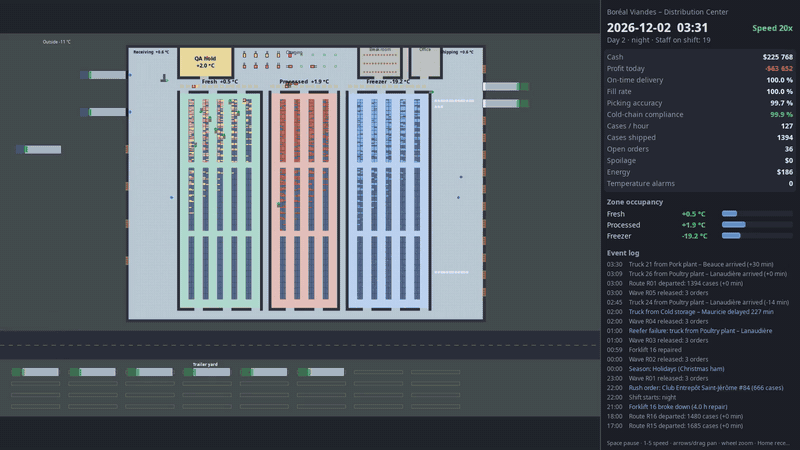

# Boréal Viandes – Cold-Chain Warehouse Simulation

An animated simulation of a refrigerated meat **distribution center** in Québec. It also
**generates realistic operational data** for dashboards and machine-learning models that answer
the questions a distribution-center manager asks every day:

- How many pickers do we need tomorrow?
- Which pallets will expire before they ship?
- Which orders are at risk of leaving late?
- Is the freezer drifting toward an alarm?
- What happens to cost and service if we cut or add staff?

The company, plants, stores and products are fictional. The data is simulated on purpose: the
generating process is known, so every model can be checked against a controlled ground truth.



## What is simulated

| Area | Details |
|---|---|
| **Inbound** | Reefer trucks from 4 plants with realistic lateness. A probe temperature check on arrival decides accept, QA hold or reject. Reefer failures happen. |
| **Storage** | Fresh (-1 to 2 °C), processed (0 to 4 °C) and freezer (-20 °C) rooms with rack slots. Each pallet has a lot, a pack date and a best-before date. Product temperature lags room air (thermal mass), and excursions go to QA. |
| **Orders** | 12 stores (grocery, club, restaurant) on 6 delivery routes with cutoffs. Demand follows weekday, seasonal (Christmas ham, summer BBQ, BBQ heat sensitivity) and random variation. |
| **Picking & shipping** | FEFO picking onto mixed pallets with catch weights. Pallets are wrapped, staged, and loaded last stop first, and trucks leave in their departure window. |
| **People & equipment** | Day, evening and night shifts. Receivers, forklift drivers, pickers, loaders and QA, each with an individual skill. Forklifts have batteries, chargers and breakdowns. |
| **Events** | Late trucks, reefer failure, freezer door stuck open, forklift breakdown, sick calls, rush orders, lot recalls with traceability. |
| **Economy** | Revenue per case, wages, energy (the freezer costs the most), spoilage, penalties, and the cold-chain compliance KPI. |

The interface is French (Québec) by default; press **L** for English.


## Quick start

```bash
python -m venv .venv && source .venv/bin/activate
pip install -r requirements.txt        # pygame-ce only
python main.py
```

| Key | Action |
|---|---|
| Space | Pause |
| 1 – 5 | Speed 1x / 2x / 5x / 10x / 20x |
| Arrows or drag | Pan |
| Mouse wheel | Zoom |
| Home | Recenter |
| L | Français ↔ English |
| F5 / F9 | Save / load |

## Generate data (headless)

```bash
python main.py --headless --days 180 --seed 42 --scenario baseline
```

The data is written as a star schema of CSV tables to `data/<scenario>_seed<seed>/`. It loads
straight into Power BI, pandas or SQLite. Runs are reproducible: the same seed gives the same
data, and 60 simulated days take about 11 seconds.

- **Dimensions:** `dim_sku`, `dim_store`, `dim_route`, `dim_plant`, `dim_zone`, `dim_worker`
- **Facts:** `fact_orders`, `fact_order_lines`, `fact_picks`, `fact_shipments`, `fact_shipment_lots`,
  `fact_pallet_receipts`, `fact_inbound_trucks`, `fact_putaway`, `fact_inventory_daily`,
  `fact_temperature`, `fact_energy_daily`, `fact_weather`, `fact_labor`, `fact_equipment`,
  `fact_events`, `fact_daily_kpi`

Every table and column is documented in **[DATA_DICTIONARY.md](DATA_DICTIONARY.md)**,
including the cause-and-effect built into the data.

## SQL analytics

```bash
pip install -r requirements-analytics.txt
python analytics/build_db.py                       # all runs in data/ -> data/warehouse.db (SQLite star schema)
python analytics/run_sql.py                        # run every KPI query (scenario baseline)
python analytics/run_sql.py 06 --scenario chaos    # one query, another scenario
```

`analytics/sql/` holds the nine queries a distribution-center manager asks for: daily OTIF,
service by customer, cold-chain compliance, expiry risk, picker productivity, supplier scorecard,
recall trace, scenario comparison and spoilage drivers. For example, the supplier scorecard and the
spoilage-drivers query show that **every spoiled pallet came from an aged poultry load**, which
arrived with about 3 days of shelf life left.

Scenarios for what-if comparisons (180 simulated days, seed 42, from `analytics/sql/08_scenario_comparison.sql`):

| Scenario | On-time | Fill rate | Wages / day | Late and expedite cost / day | Profit / day |
|---|---|---|---|---|---|
| `baseline` | 98.0 % | 99.44 % | $5,128 | $511 | **$2,500** |
| `lean_staff` (fewer pickers and drivers) | 96.5 % | 99.37 % | $4,098 | $613 | $2,031 |
| `extra_pickers` | 99.7 % | 99.29 % | $6,134 | $520 | $1,434 |
| `chaos` (5x more incidents) | 98.2 % | 98.43 % | $5,141 | $1,242 | -$336 |
| `summer_bbq` (June start, BBQ peak) | 97.9 % | 99.45 % | $5,120 | $519 | $4,179 |

Cutting staff saves $1,000 a day in wages but loses more in late deliveries and bad days. Extra
pickers buy near-perfect punctuality at a cost the service gain doesn't repay. This is the
trade-off the labour-planning model will optimise.

## Tests

```bash
pip install -r requirements-dev.txt
python -m pytest tests/ -q
```

## Record videos

```bash
python main.py --record videos/day.mp4 --hours 24 --speed 20 --camera site
```

This renders offscreen and needs `ffmpeg`. The camera presets are `site`, `receiving`,
`shipping`, `freezer` and `picking`. Use `--warmup H` to skip ahead to a busy hour, and
`--lang en` for English.

## Project layout

| File | Role |
|---|---|
| `config.py` | Every tuning number, product, store, plant and scenario |
| `simulation.py` | All warehouse logic on a fixed time step (no pygame, runs headless) |
| `models.py` | Dataclasses: SKU, Pallet, RackSlot, Truck, Order, Worker, Forklift… |
| `pathfinding.py` | A* on the floor grid |
| `events.py` | Random and seasonal events |
| `datalog.py` | CSV star-schema export |
| `renderer.py`, `ui.py` | Drawing, camera, sidebar |
| `i18n.py` | French / English text |
| `main.py` | Game loop, headless mode, video recording |

## Roadmap

- [x] Simulation core, animated game, headless data export, video recording
- [x] Tests: case conservation, reproducibility, no-deadlock regressions, save/load, staffing signal
- [x] Economy and realism calibration: staffing and events move service levels (table below)
- [x] Data dictionary, SQLite star schema and KPI SQL queries
- [x] Realistic supply problems: short shipments, aged loads, buyer order error (spoilage ≈ 0.5 %, fill rate ≈ 99.4 %)
- [ ] Power BI dashboards: operations, cold chain, inventory and expiry, labour, recall trace, scenario comparison
- [ ] ML models, each against a naive baseline with the $ impact: demand forecast, labour planning, spoilage risk, late-shipment risk, temperature anomaly detection

## Tech

Python 3.11+, pygame-ce. The analytics layer will add pandas, scikit-learn and Jupyter.
